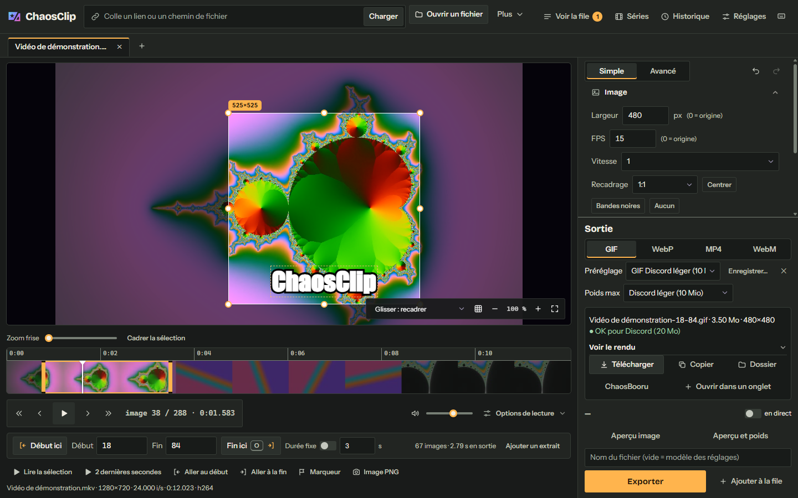
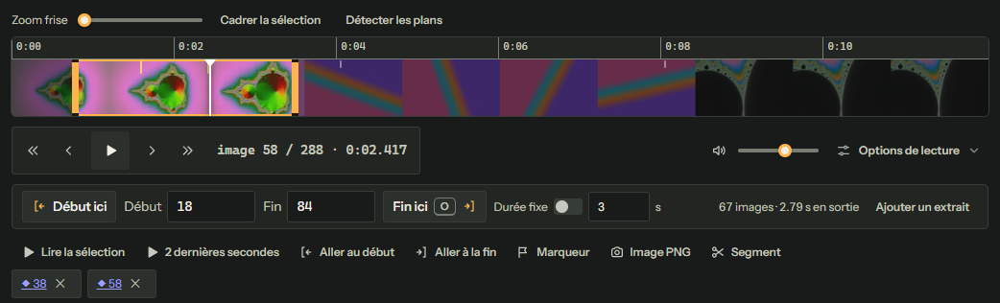
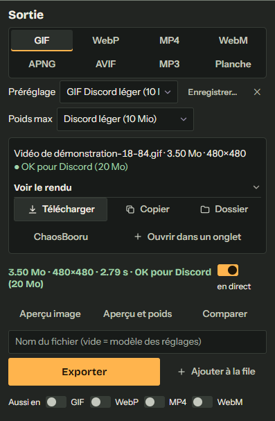

  

<h1 align="center">ChaosClip</h1>

  <b>Le GIF parfait, à l'image près.</b> 
  Colle un lien, coupe à l'image près, exporte en GIF, WebP, MP4, WebM, APNG ou AVIF, 
  puis envoie le résultat sur Discord ou ChaosBooru. Appli Windows et Android, locale et gratuite, pensée pour Chaos:Reborn.

  
  
  
  

  
  

  <a href="#fonctionnalités">Fonctionnalités</a> ·
  <a href="#installation">Installation</a> ·
  <a href="#utilisation">Utilisation</a> ·
  <a href="#chaosbooru">ChaosBooru</a> ·
  <a href="#développement">Développement</a>

  

  Capture réelle de la version 1.5.0 : recadrage 1:1, texte posé sur l'image, GIF exporté et pesé pour Discord. La vidéo affichée est une vidéo de test générée avec ffmpeg.

## En bref

| | |
|---|---|
| 🎯 **Précis** | Tu choisis le début et la fin au numéro d'image, pas à la seconde. |
| ⚖️ **Au bon poids** | Tu fixes un poids max (10 ou 20 Mio pour Discord, ou ta valeur) et l'export s'y tient tout seul. |
| 🌐 **Toutes les sources** | Lien YouTube, TikTok, Twitch et [tous les sites gérés par yt-dlp](https://github.com/yt-dlp/yt-dlp/blob/master/supportedsites.md), fichier local, suite d'images, capture d'écran. |
| 💬 **Prêt à partager** | Copier puis <kbd>Ctrl</kbd>+<kbd>V</kbd> dans Discord, glisser vers Discord, webhook, ou envoi sur ChaosBooru. |
| 🏠 **Sur ton PC** | L'appli tourne en local et n'est joignable que depuis ta machine. ffmpeg est inclus, rien d'autre à installer. |

## Fonctionnalités

### Découpe à l'image près

  

- **Image par image** : molette sur la vidéo, flèches, <kbd>J</kbd> / <kbd>K</kbd> / <kbd>L</kbd>, pas réglable (1, 5, 10 images ou 1 s).
- **Début et fin au numéro d'image ou au temps** : <kbd>I</kbd> et <kbd>O</kbd>, ou saisie directe, en images ou en secondes (55,2) selon l'unité choisie à côté des champs ; durée fixe si tu veux que la fin suive le début.
- **Frise avec miniatures**, zoom jusqu'à une image par vignette (<kbd>Ctrl</kbd> + molette), avec le numéro et le temps de chaque image sur la règle, et sélection à la souris aimantée aux plans et aux marqueurs.
- **Détection des changements de plan** et **marqueurs**, avec saut de l'un à l'autre (<kbd>Pg↑</kbd> / <kbd>Pg↓</kbd>).
- **Enlever un passage au milieu** : un moment gênant dans le clip se retire en deux clics (première image, dernière image), les deux côtés restent collés dans un seul fichier. La lecture de la sélection le saute, comme l'export.
- **Segments** : plusieurs passages collés dans un seul clip, avec arrêt sur image possible à la fin d'un segment.

### Export et partage

| Format | En deux mots |
|---|---|
| **GIF** | Compatible partout. Palette sur mesure, tramage, nombre de couleurs, compression gifsicle. |
| **WebP** | Animé, bien plus léger qu'un GIF. |
| **MP4** | Vidéo H.264, avec accélération matérielle en option. |
| **WebM** | Vidéo VP9. |
| **APNG** | PNG animé (stickers Discord). |
| **AVIF** | AVIF animé, encodage lent. |
| **MP3** | Le son seul. |
| **PNG** | L'image affichée. |
| **Planche** | Planche contact / sprite sheet. |

<table>
<tr>
<td width="360" valign="top">

</td>
<td valign="top">

**Le poids, sans tâtonner**

- Estimation du poids, en direct si tu veux.
- Poids max atteint automatiquement ; tu choisis ce qui est réduit en premier : la taille, la fluidité ou la qualité.
- Comparaison A/B de deux réglages côte à côte.

**Par lots**

- File d'attente d'exports.
- Plusieurs formats d'un coup.

**Partage**

- **Copier**, puis <kbd>Ctrl</kbd>+<kbd>V</kbd> dans Discord.
- **Glisser** vers Discord ou un dossier (appli Windows).
- Envoi dans un salon Discord par **webhook**.
- Envoi sur **ChaosBooru** (Chaos Tools).

**Préréglages Discord fournis**

GIF standard (20 Mio), GIF léger (10 Mio), WebP léger, MP4 standard (20 Mio), emoji (128 px, 256 Ko), sticker (APNG 320 px, 512 Ko), avatar animé (GIF 512 px), bannière de profil (GIF 680×240). Tu peux enregistrer les tiens.

</td>
</tr>
</table>

### Tout le reste

| | |
|---|---|
| **Sources** | Une URL (YouTube, TikTok, Dailymotion, Twitter/X, Twitch, Bilibili et [tous les sites gérés par yt-dlp](https://github.com/yt-dlp/yt-dlp/blob/master/supportedsites.md)), plusieurs URL d'un coup, une playlist, un fichier glissé dans la fenêtre, une suite d'images, ou une capture d'écran. Avant de télécharger : choix de la qualité, de la langue audio, des sous-titres, ou seulement d'un passage. Un site non pris en charge donne un message clair. |
| **Image** | Recadrage à la souris (libre, 1:1, 16:9, 4:3, 9:16, bannière), recadrage qui suit un personnage, suppression des bandes noires, rotation, miroir, zones floues, fond transparent à la pipette. |
| **Animation** | Vitesse, ralenti fluide, boucle, aller-retour, lecture inversée, fondu en boucle, fondus d'entrée et de sortie, zoom progressif. |
| **Effets** | Luminosité, contraste, saturation, gamma, netteté, débruitage, noir et blanc, sépia, désentrelacement. |
| **Texte** | Plusieurs textes déplaçables avec police, couleur, contour et durée ; sous-titres de la vidéo ou d'un fichier `.srt` / `.ass` ; logo. |
| **Onglets** | Chaque vidéo ou image ouverte a son onglet, avec ses réglages et sa position ; un export se rouvre dans un onglet pour le retravailler. Les images fixes et les WebP animés s'ouvrent aussi. |
| **Confort** | Modes Simple et Avancé, projets enregistrés, historique avec « Refaire », annuler / rétablir, raccourcis modifiables, thème clair ou sombre, interface en français ou en anglais. |

## Installation

### Appli Windows (conseillé)

1. Télécharge `ChaosClip-Setup-x.y.z.exe` dans les [Releases](https://github.com/DevLuho/ChaosClip/releases).
2. Installe-le. Rien d'autre à installer : ffmpeg est inclus, yt-dlp se télécharge au premier lancement.

L'installateur ajoute un raccourci sur le bureau et **« Ouvrir avec ChaosClip »** au clic droit sur une vidéo. Les mises à jour se téléchargent seules et s'installent à la fermeture. Les exports vont dans `Vidéos\ChaosClip`.

### Sans installateur

1. Installe [Node.js](https://nodejs.org) (LTS).
2. Télécharge ce dépôt.
3. Double-clique sur **`Lancer ChaosClip.bat`** (les dépendances s'installent au premier lancement).

L'appli s'ouvre dans le navigateur sur http://localhost:4870 (accessible depuis ton PC seulement). Les exports vont dans `exports/`.

### Android

1. Sur ton téléphone, télécharge `ChaosClip-x.y.z-arm64-v8a-release.apk` dans les [Releases](https://github.com/DevLuho/ChaosClip/releases/latest).
2. Ouvre le fichier, et autorise l'installation quand Android le demande.

Android 7 ou plus récent. C'est la même appli que sur PC, adaptée au doigt, et tout se passe sur le téléphone :

- **Ouvrir** : colle un lien, choisis un fichier, ou touche « Partager » dans YouTube, ton navigateur ou ta galerie et choisis ChaosClip.
- **Découper** : glisse les deux poignées de la frise, pince-la pour zoomer, glisse sur la vidéo pour recadrer.
- **Envoyer** : **Partager** ouvre Discord (ou une autre appli) avec l'export, **Enregistrer** le range dans la galerie (Android 10 ou plus récent).

Un export ou un téléchargement continue quand tu changes d'appli, et une notification prévient à la fin. L'appli propose ses mises à jour au démarrage : un appui, puis Android demande de confirmer.

> Première version Android, mise au point sur émulateur : si quelque chose coince sur ton téléphone, signale-le dans les [Issues](https://github.com/DevLuho/ChaosClip/issues).

## Utilisation

1. **Ouvre** : colle une URL ou un chemin (<kbd>Ctrl</kbd>+<kbd>V</kbd> n'importe où), ou glisse une vidéo dans la fenêtre.
2. **Coupe** : place-toi sur la première image et appuie sur <kbd>I</kbd>, sur la dernière et appuie sur <kbd>O</kbd>.
3. **Cadre** : glisse sur la vidéo pour recadrer, règle le format à droite (mode Simple ou Avancé).
4. **Exporte** : **Exporter** (<kbd>Ctrl</kbd>+<kbd>Entrée</kbd>). Puis **Copier** et <kbd>Ctrl</kbd>+<kbd>V</kbd> dans Discord, ou **ChaosBooru**.

Toutes les touches : bouton **?** (ou touche <kbd>?</kbd>). Elles se changent dans Réglages › Raccourcis clavier.

<b>Raccourcis par défaut</b>

 

| Action | Touches |
|---|---|
| Lecture / pause | <kbd>Espace</kbd> ou <kbd>K</kbd> |
| Image précédente / suivante (selon le pas) | <kbd>←</kbd> ou <kbd>J</kbd> / <kbd>→</kbd> ou <kbd>L</kbd> |
| 10 images en arrière / en avant | <kbd>Maj</kbd>+<kbd>←</kbd> / <kbd>Maj</kbd>+<kbd>→</kbd> |
| Début / fin de la sélection ici | <kbd>I</kbd> / <kbd>O</kbd> |
| Début −1 / +1 image | <kbd>Alt</kbd>+<kbd>←</kbd> / <kbd>Alt</kbd>+<kbd>→</kbd> |
| Fin −1 / +1 image | <kbd>Ctrl</kbd>+<kbd>←</kbd> / <kbd>Ctrl</kbd>+<kbd>→</kbd> |
| Lire la sélection | <kbd>P</kbd> |
| Aller au début / à la fin de la sélection | <kbd>Début</kbd> / <kbd>Fin</kbd> |
| Plan ou marqueur précédent / suivant | <kbd>Pg↑</kbd> / <kbd>Pg↓</kbd> |
| Ajouter un marqueur | <kbd>M</kbd> |
| Ajouter la sélection aux segments | <kbd>N</kbd> |
| Enlever un passage du clip (première image, puis dernière) | <kbd>X</kbd> |
| Ajouter un extrait (séries) | <kbd>Maj</kbd>+<kbd>Entrée</kbd> |
| Enregistrer l'image en PNG / la copier | <kbd>S</kbd> / <kbd>C</kbd> |
| Aller à une image ou un temps | <kbd>G</kbd> |
| Cadrer la frise sur la sélection | <kbd>Z</kbd> |
| Couper le son / plein écran | <kbd>U</kbd> / <kbd>F</kbd> |
| Aperçu de l'image / aperçu et poids | <kbd>A</kbd> / <kbd>E</kbd> |
| Exporter | <kbd>Ctrl</kbd>+<kbd>Entrée</kbd> |
| Annuler / rétablir | <kbd>Ctrl</kbd>+<kbd>Z</kbd> / <kbd>Ctrl</kbd>+<kbd>Y</kbd> |
| Nouvel onglet / fermer / rouvrir | <kbd>Ctrl</kbd>+<kbd>T</kbd> / <kbd>Ctrl</kbd>+<kbd>W</kbd> / <kbd>Ctrl</kbd>+<kbd>Maj</kbd>+<kbd>T</kbd> |
| Onglet suivant / précédent | <kbd>Ctrl</kbd>+<kbd>Tab</kbd> / <kbd>Ctrl</kbd>+<kbd>Maj</kbd>+<kbd>Tab</kbd> |
| Aide-mémoire | <kbd>?</kbd> |

**À la souris** : molette sur la vidéo = image par image, <kbd>Ctrl</kbd> + molette = zoom, glisser = recadrer. Sur la frise : clic = se placer, poignées = début et fin, <kbd>Ctrl</kbd> + glisser dans la sélection = la déplacer, <kbd>Maj</kbd> + glisser = nouvelle sélection (aimantée aux plans et marqueurs, <kbd>Alt</kbd> pour l'éviter). Clic droit : actions courantes.

## ChaosBooru

Après un export en GIF, WebP ou PNG, **ChaosBooru** ouvre le formulaire : titre, support, tags, personnages et œuvres. L'envoi crée la contribution et la soumet à la modération (ou la garde en brouillon).

### ChaosBoo

Une fois connecté, **ChaosBoo**, l'assistant de classement du site, s'affiche en bas à droite de la fenêtre ChaosBooru. Il regarde ton export (les instants marquants d'une animation) et propose une fiche : titre, description, œuvre, saga, personnages et tags. Tu gardes d'un clic ce qui est juste, rien n'est ajouté sans toi. C'est le panneau du site lui-même, chargé en direct : ChaosClip relaie seulement ses appels avec ta connexion. Les images réduites partent sur Chaos Tools, puis vers une IA externe ; l'analyse est reprise sans être recomptée quand tu envoies le fichier.

### Connexion

Réglages › ChaosBooru › **Se connecter à Chaos Tools** (applis Windows et Android : la page du site s'ouvre, on se connecte par Discord comme d'habitude). Dans le navigateur, colle à la place ton jeton : sur le site, <kbd>F12</kbd> › Application › Stockage local › `chaos_token`. Le jeton reste sur ton PC (`data/booru.json`) et n'est jamais envoyé ailleurs qu'à Chaos Tools.

### Séries d’extraits

Pour sortir plusieurs passages d'un même épisode d'une traite.

1. Ouvre l’épisode, marque un passage avec <kbd>I</kbd> et <kbd>O</kbd>, donne-lui un nom si tu veux, puis clique sur **Ajouter ce passage** (ligne « Plusieurs GIF », sous la frise) ou appuie sur <kbd>Maj</kbd>+<kbd>Entrée</kbd>. Répète pour les autres passages.
2. Clique sur **Voir les passages**, à côté, ou ouvre **Séries** en haut de la fenêtre. Tu peux réordonner les passages, indiquer la source, l’œuvre et la saga, et **Préparer tous les fichiers**.
3. Relis chaque extrait avec ses deux fichiers, puis valide-le. **Copier le GIF** et **Glisser le GIF** servent à joindre le fichier dans Discord. Le WebP s’ouvre dans l’éditeur ChaosBooru avec son brouillon local. Tu peux enregistrer un brouillon sur le site, soumettre le clip ou télécharger le WebP avec son classement intégré.

Les séries et les brouillons locaux sont sauvegardés au fil de l’eau. À la réouverture, la file reprend les encodages interrompus et retrouve les fichiers terminés. Pour convertir un montage déjà enregistré, utilise **Plus › Projets enregistrés › Créer une série**, puis choisis de conserver le montage complet ou de créer un extrait par segment.

## Avertissement

> [!WARNING]
> ChaosClip utilise [yt-dlp](https://github.com/yt-dlp/yt-dlp) et [ffmpeg](https://ffmpeg.org). Tu es responsable de ce que tu télécharges : respecte les droits d'auteur et les conditions des sites.
>
> L'appli ne contourne aucune protection (DRM) : les contenus protégés (Crunchyroll, Netflix…) ne sont pas pris en charge. Les cookies du navigateur (réglage optionnel) servent seulement aux vidéos que ton compte peut déjà voir.

## Développement

Une interface web sans framework (`public/`), servie par un serveur Express local (`server.js`, `lib/`) qui pilote ffmpeg, ffprobe, gifsicle et yt-dlp, le tout emballé dans Electron (`electron/`). Node.js 18 ou plus récent.

| Commande | Effet |
|---|---|
| `npm start` | Serveur seul (navigateur). |
| `npm run app` | Appli Electron. |
| `npm run dist` | Installateur Windows dans `dist/`. |
| `npm run apk` | APK Android signés ; celui des téléphones (arm64-v8a) est joint à la release de la version courante. |
| `npm test` | Génère une vidéo de test et vérifie chaque format, la précision à l'image, le poids max et l'envoi ChaosBooru (contre un faux Chaos Tools). |

Chaque push sur `main` et chaque pull request lancent les tests sur Windows et Linux et construisent un installateur de test (onglet *Actions › Artifacts*).

**Publier une version** : changer `version` dans `package.json`, pousser, puis *Actions › Release › Run workflow* : il crée le tag `vX.Y.Z`, construit l'installateur et le publie dans les Releases, où l'appli installée va chercher ses mises à jour. Ensuite, `npm run apk` sur le PC qui détient la clé de signature (`android/keystore.properties`) y joint l'APK des téléphones (celui de l'émulateur, x86_64, reste dans `android/app/build/outputs/apk/release/`) : l'appli Android ne propose une version que lorsque son APK est là.

**Appli Android** (`android/`) : le même serveur, lancé dans l'appli par [nodejs-mobile](https://github.com/nodejs-mobile/nodejs-mobile) et affiché dans une WebView ; ffmpeg et yt-dlp viennent de [youtubedl-android](https://github.com/yausername/youtubedl-android). `gradlew assembleDebug` dans `android/` construit un APK de test (Android SDK, NDK et CMake requis).

## Licence

Licence MIT.
